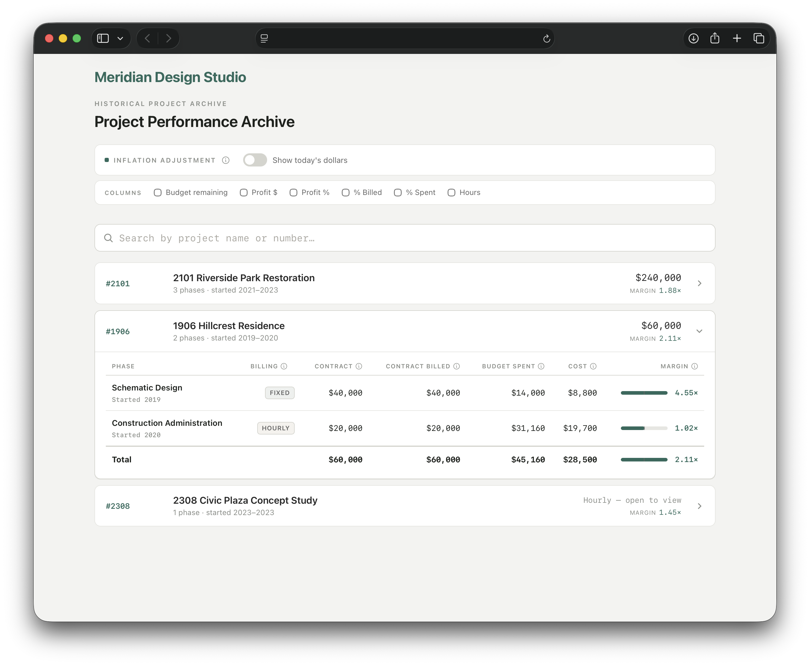
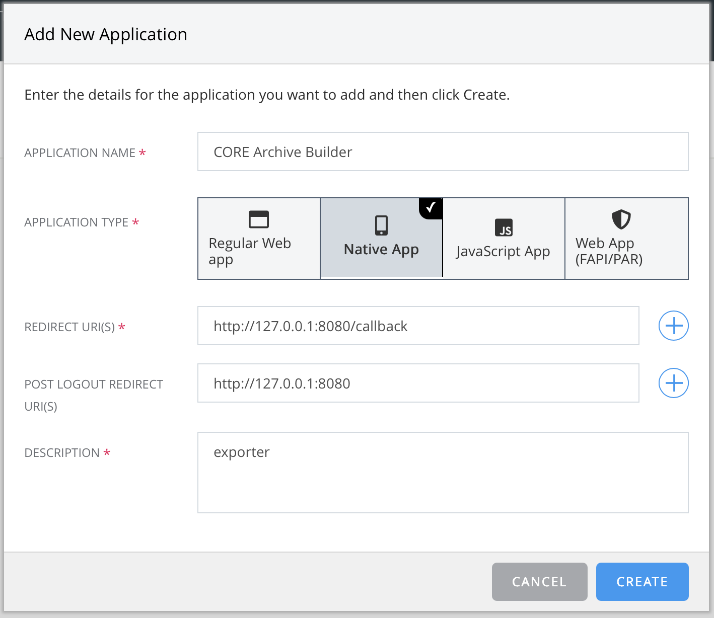
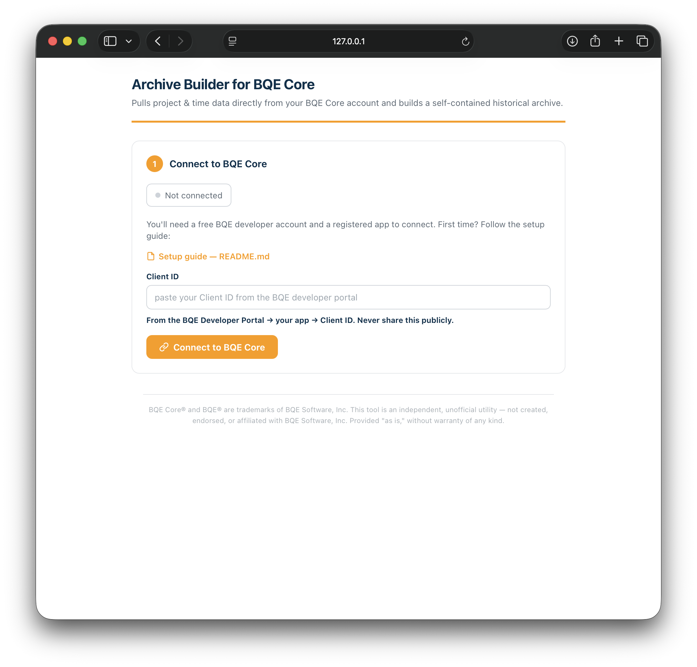
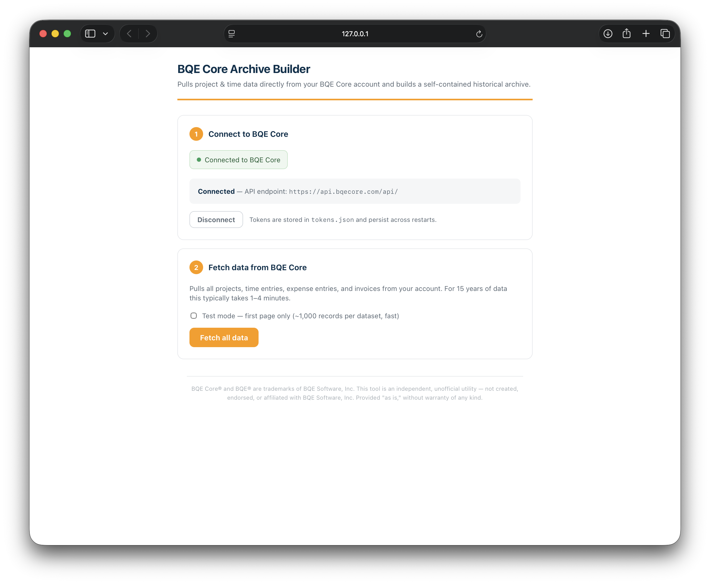

# Archive Builder for BQE Core

A small local tool that reads your firm's project, time, expense, and invoice
data **directly from the BQE Core API** and builds a **self-contained HTML
archive** of historical project performance — one file you can open in any
browser, keep offline, and hand to anyone.

It was built to preserve project history when moving off BQE Core, and it
bypasses Core's "Export as CSV," which silently truncates large pulls.

Everything runs on your own machine. Your Core data is granted only to *your*
registered app and flows straight into your computer — it never passes through
anyone else's server.



*The generated archive (shown with fictional sample data): searchable projects,
expandable phases, inflation adjustment, and optional performance columns.*

---

## What it does

1. **Connects** to BQE Core over OAuth (read-only).
2. **Fetches** all projects, time entries, expense entries, and invoices via the API.
3. **Joins** them into a project → phase tree with confirmed financials:
   - **Contract** — contracted fee per phase.
   - **Contract billed** — fees invoiced (excludes reimbursable "Billed Extra" pass-throughs).
   - **Budget spent** — all time × bill rate (billable *and* non-billable) plus non-extra expense charges.
   - **Cost** — all time × cost rate plus all expense costs.
   - **Hours by role** — total hours bucketed by staff classification (falls back to bill rate when unclassified).
4. **Builds** a branded, standalone archive HTML file with the data baked in.
5. Optionally **exports** the raw fetched data as CSV for a full data dump.

The generated archive needs no server and no internet — all data and logic are
embedded in the single file.

---

## Requirements

- **Python 3.8+** — standard library only. There are **no third-party
  dependencies**; nothing to `pip install`.
- A free **BQE Core developer account** and a registered app (one-time, see below).
- An active BQE Core company subscription (the account you normally sign in with).

---

## Running the tool

```bash
python3 server.py
```

This starts a local server at **http://127.0.0.1:8080** and opens the builder
in your browser. Press `Ctrl+C` to stop it.

> The server binds to `127.0.0.1:8080` on purpose — it must match the OAuth
> redirect URI you register with BQE (below). If you change the port, change it
> in `auth.py` (`PORT`) and re-register the redirect URI to match.

Once running, the builder walks you through three steps: **Connect → Fetch →
Review & build.**

### Preview without connecting

A ready-made demo built from **fake sample data** is included —
**[download the sample archive](https://github.com/markwarfel/Archive-Builder-for-BQE-Core/releases/latest/download/sample-archive.html)**
and open it in any browser. (It's also in the repo as
[`sample-archive.html`](sample-archive.html) — on GitHub, use **Download raw
file** to save it, since GitHub shows `.html` as source in the browser.)

To regenerate it yourself (no BQE account needed):

```bash
python3 build_sample.py
```

Everything in the sample is fictional — it's just there to demonstrate the output.

---

## One-time setup: register a BQE developer app (~5–10 min)

Because of how Core's API works, **each firm registers its own free app** and
runs this tool with that app's Client ID.

### Part 1 — Create a developer account (~2 min)

1. Go to **https://api-developer.bqecore.com** and click **Sign Up → Get Started**.
2. Enter your name, email, and a password. **Any email works** — it does *not*
   have to be the one you use to log in to Core. (This developer account is
   separate from your normal Core login; that's expected.)
3. Agree to the **Developer Agreement** and click **Sign Up**.
4. Click the **activation link** BQE emails you.

Creating the account and app is **free**.

### Part 2 — Register the app (~3 min)

On the Developer Portal dashboard, click **Add New Application** and use
**exactly** these settings:

| Setting | Value | Why |
|---|---|---|
| **Application Name** | anything, e.g. `Core Archive Builder` | just a label |
| **Application Type** | **Native App** | public/PKCE type with **no Client Secret** — safe to run locally |
| **Redirect URI** | `http://127.0.0.1:8080/callback` | must match the tool **character-for-character** |
| **Post Logout Redirect URI** | `http://127.0.0.1:8080` | must match the tool's base URL |
| **Description** | anything | — |

Click **Create**, open the app, and **copy its Client ID**.



Because **Native App** is a public type, there is **no Client Secret** — that's
correct, don't look for one.

> ⚠️ Register the Redirect URI as `http://127.0.0.1:8080/callback` exactly.
> Core matches it precisely: `http` vs `https`, `127.0.0.1` vs `localhost`, a
> trailing slash, the port, and capitalization all count. A mismatch produces an
> error page instead of a login screen.

The tool requests two scopes when you connect:

- **`read:core`** — read-only access; it can never change anything in Core.
- **`offline_access`** — lets it refresh quietly so you're not re-logging in each run.

### Part 3 — Connect

1. In the builder (Step 1), paste your **Client ID** and click **Connect to BQE Core**.
2. Sign in on **Core's own login screen** with your normal Core credentials,
   pick your company, and **Grant Permission**.



The Client ID is stored in `config.json` and your tokens in `tokens.json`, both
local to this folder, so you stay connected across restarts.

---

## Using the builder

**Step 2 — Fetch.** Click **Fetch all data**. For 15 years of history this
typically takes 1–4 minutes.



**Step 3 — Review & build.**

- **Projects to include** — check/uncheck which projects go into the archive.
- **Brand** — firm name, archive title, and accent color.
- **Build & download archive** — produces `your-firm-archive-YYYY-MM-DD.html`.
- **Export raw data** — download the raw fetched records as CSV (see below).

---

## The generated archive

Open the downloaded HTML file in any browser — no server needed. Features:

- **Search** by project name or number.
- **Expandable phases** with Contract, Contract billed, Budget spent, Cost, and a Margin bar.
- **Inflation adjustment** — toggle "Show today's dollars" to restate historical
  figures using the Producer Price Index for Architectural, Engineering, and
  Related Services (BLS series **PCU54135413**, annual averages). You can also
  enter a custom PPI value.
- **Optional columns** (toggles under "Columns") — Budget remaining, Profit $,
  Profit %, % Billed, % Spent, and Hours. Hidden by default; losses and
  over-budget percentages show in red.
- **Hours by role** — the Hours column breaks total hours down per staff
  classification for each phase.
- **Horizontal scroll** — when many columns are shown, the table scrolls
  sideways with a visible scrollbar and an edge fade hinting at more.

---

## Raw CSV export

The **Export raw data** buttons in Step 3 download the raw records from your most
recent fetch, one file per dataset:

- `projects.csv`
- `time-entries.csv`
- `expenses.csv`
- `invoices.csv` — flattened to **one row per invoice detail line**.

Time-entry, expense, and invoice rows are enriched with leading `project_name`
and `phase_name` columns so you don't have to resolve project ID UUIDs by hand.
Files are UTF-8 with a BOM so Excel opens them cleanly.

---

## Data & privacy

- The app requests **read-only** access — it cannot edit or delete anything in Core.
- All processing is local. Data is fetched straight to your machine; nothing is
  sent to any third-party server.
- Credentials live in local files next to `server.py`: `config.json` (your
  Client ID) and `tokens.json` (OAuth tokens). Delete them or click
  **Disconnect** to remove them.

**Security notes**

- The server listens only on `127.0.0.1` (localhost) — it is not exposed to your
  network. Don't put it behind a public proxy or bind it to `0.0.0.0`.
- `tokens.json` stores your OAuth access/refresh tokens **unencrypted**. Treat it
  like a password: don't commit it, and avoid running the tool on a shared or
  untrusted machine. It is already listed in `.gitignore`.
- Your BQE Client ID (in `config.json`) is not a secret for a Native/PKCE app,
  but there's no reason to publish it either — it's gitignored by default.

---

## Troubleshooting

- **Error page right after login / "redirect_uri mismatch"** → the registered
  Redirect URI doesn't exactly match `http://127.0.0.1:8080/callback`. Recheck
  `http` vs `https`, `127.0.0.1` vs `localhost`, trailing slash, and port.
- **`invalid_scope`** → the app must be allowed the `read:core` scope.
- **"App can only interact with companies with a valid subscription"** →
  expected; the Core company needs an active paid subscription.
- **It worked, then stopped after ~1 hour** → access tokens last about an hour.
  The refresh token (from *offline access*) renews it automatically; if you
  declined offline access, just reconnect.
- **A phase's Budget spent differs slightly from Core** → some very old entries
  aren't reachable through the API; the archive notes this in the column tooltip.

---

## Status & contributing

This was built to solve a specific one-time need (preserving project history when
leaving BQE Core) and is shared **as-is**. It is **not actively maintained** — the
original author is unlikely to add features or provide ongoing support.

That said, it's MIT-licensed and yours to build on:

- **Found a bug or have a question?** Open an issue — others in the community may
  pick it up, even if the author doesn't.
- **Want to improve it?** Fork it and open a pull request, or just maintain your
  own fork. No CLA, no process.
- The code is deliberately small and dependency-free to keep forking easy.

## Project layout

| File | Role |
|---|---|
| `server.py` | Starts the local HTTP server. |
| `handler.py` | Request routing: OAuth, `/fetch` (SSE progress), `/download/*.csv`. |
| `auth.py` | OAuth PKCE flow, token/config storage. |
| `bqe.py` | Paginated BQE API client. |
| `join.py` | Aggregates T&E + invoices into the project → phase tree. |
| `index.html` | The builder UI. |
| `archive-template.html` / `archive-template.css` | Template for the generated archive (data injected at build time). |

BQE Core® and BQE® are trademarks of BQE Software, Inc. This tool is an
independent, unofficial utility — not created, endorsed, or affiliated with BQE
Software, Inc. Provided "as is," without warranty of any kind.
